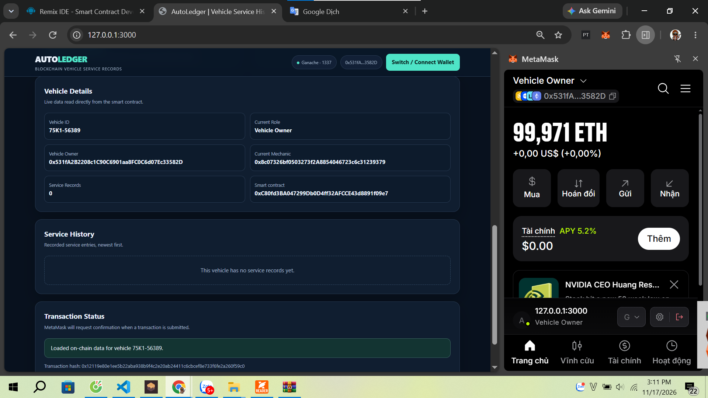
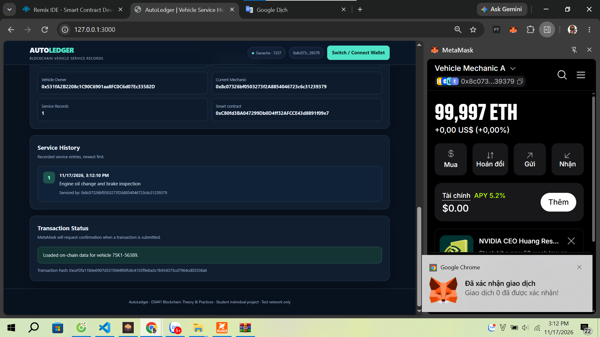

# AutoLedger — Vehicle Service History (DS441)

**Individual Mini Project — Blockchain: Theory & Practices (DS441 A)**  
**Student:** Trương Nhật Trường — **Student ID:** 29211164915  
**Project:** Vehicle Service History on a local Ethereum blockchain.

## 1. Project objective and features

AutoLedger maintains a vehicle's service history using a unique **vehicle identifier** on a local Ethereum test blockchain. A vehicle owner can register a vehicle and appoint or replace its authorized mechanic. **Only the currently authorized mechanic** can add a dated service record; anyone may look up the vehicle and its history. Solidity enforces these permissions using `msg.sender`, rather than relying only on front-end controls.

| Role | Permissions |
|---|---|
| Vehicle Owner | Register an unregistered vehicle with their wallet; appoint or replace its mechanic |
| Authorized Mechanic | Add a service description with a blockchain timestamp |
| Other wallet / Viewer | Read the publicly available history; cannot add records without authorization |

**Smart contract:** `contracts/VehicleServiceHistory.sol` exposes `registerVehicle`, `authorizeMechanic`, `addService`, `getVehicle`, and `getService`, and emits `VehicleRegistered`, `MechanicAuthorized`, and `ServiceAdded`. The contract stores vehicle identifiers, wallet addresses, service descriptions, and timestamps. It **does not verify real-world vehicle ownership documents**.

## 2. Technology stack and project files

- **Solidity `^0.8.24`**; compiled in Remix with **EVM target `paris`** for compatibility with the Ganache GUI workspace configured with the Merge hardfork.
- **Ganache GUI:** local Ethereum blockchain using test ETH.
- **MetaMask:** wallet connection and transaction signing using Ganache test accounts.
- **Remix IDE:** compiled and deployed the demonstrated contract.
- **Hardhat, ethers.js, Chai:** compilation and automated tests; `scripts/deploy.js` provides an alternative deployment method.
- **HTML, CSS, JavaScript, ethers.js v6:** the AutoLedger browser interface in `frontend/`.
- **Web3.py:** `scripts/read_history.py` provides an optional read-only Python example; it is not the main web interface.

```text
contracts/VehicleServiceHistory.sol
frontend/index.html
frontend/app.js
frontend/contract.js
scripts/deploy.js
scripts/read_history.py
test/VehicleServiceHistory.test.js
hardhat.config.js
package.json
requirements-web3py.txt
README.md
docs/DEMO_AND_SCREENSHOTS.md
docs/screenshots/
```

## 3. Prerequisites and Ganache network settings

- Install **Node.js and npm**, **Google Chrome**, **MetaMask**, and **Ganache GUI**. Remix IDE is required only for the Remix deployment workflow.
- Install the Node.js dependencies using `npm install` inside the directory containing `package.json`.
- **Vehicle Ganache workspace:** RPC `http://127.0.0.1:7546`; **Chain ID `1337`**; Network ID `5778`. Network ID is **not** the Chain ID.
- Import the Ganache **test** accounts into MetaMask. Do not include private keys, recovery phrases, or any real funds in this project or repository.

> The separate SecondHand Market project also uses Chain ID 1337, but its RPC is on port 7545. Verify that MetaMask is pointing to **port 7546** before using AutoLedger. Each local workspace has its own contract state.

## 4. Build, deploy, and run

### Step 1 — Install dependencies and run tests

From the project root:

```powershell
npm install
npx hardhat compile
npm test
```

### Step 2 — Deploy with Remix IDE (the method used in the demonstration)

1. Open `contracts/VehicleServiceHistory.sol` in Remix IDE. Compile using **Solidity 0.8.24** with **EVM Version `paris`**.
2. Select the **Ganache Vehicle** network in MetaMask (RPC port `7546`, Chain ID `1337`) and the **Vehicle Owner** test account (Ganache account index 0).
3. In Remix, open **Deploy & Run Transactions**, choose **Browser Extension / MetaMask**, select `VehicleServiceHistory`, press **Deploy**, and confirm the test transaction.
4. Copy the contract address from **Deployed Contracts**. Obtain the ABI from Remix or a matching Hardhat compilation artifact.
5. Set the address and ABI in `frontend/contract.js`, using the format `window.CONTRACT_CONFIG = { address: "...", chainId: 1337, abi: [...] };`.

**Contract address in the demonstrated local workspace:** `0xC80fd3BA047299Db0D4ff32AFCCE43d8891f09e7`. This is a **local test deployment** and will not necessarily exist after resetting or switching Ganache workspaces.

> **Do not run `npm run deploy:ganache` after a Remix deployment if you want to keep using the same deployed contract and its existing data.** That script creates a new contract instance.

### Step 3 — Start AutoLedger

```powershell
npm run web
```

Visit **http://127.0.0.1:3000**, select the Ganache Vehicle network, and click **Switch / Connect Wallet**. The web application uses the Vehicle workspace's RPC endpoint. Only one web server should occupy port 3000.

**Alternative Hardhat deployment:** set the Ganache network in `hardhat.config.js` to RPC port `7546` and Chain ID `1337`, then run `npm run deploy:ganache`. This deploys a **new** instance and can generate a new `frontend/contract.js`. Choose **either** Remix **or** Hardhat for a given demonstration instance.

## 5. Demonstrated results and screenshots

**Demonstration vehicle:** `75K1-56389`  
**Owner:** `0x531fA2B2208c1C90C6901aa8F0CC6d07Ec33582D`  
**Mechanic A:** `0x8c07326bf0503273f2a8854046723c6c31239379`

### Demonstration 1 — Owner authorizes Mechanic A

The AutoLedger and MetaMask screenshot shows `Current Role: Vehicle Owner`, the `Current Mechanic` address corresponding to Mechanic A, and **0** service records before the first service. This shows the contract state after authorization.



### Demonstration 2 — Mechanic A records a completed service

The screenshot shows the Mechanic A wallet selected, **1** service record, and the description **“Engine oil change and brake inspection”**, along with the mechanic's wallet address and the timestamp displayed by the application. This documents a successful authorized service entry.



**Evidence still to collect:** an unauthorized attempt by Mechanic B before authorization; replacement of Mechanic A by Mechanic B; the old mechanic being rejected; and a successful record from the newly authorized Mechanic B. Follow [the demonstration checklist](docs/DEMO_AND_SCREENSHOTS.md) and add the resulting screenshots to `docs/screenshots/`.

## 6. Tests and evaluation

The submitted `test/VehicleServiceHistory.test.js` source is described as containing **9 automated test cases**. This is a description of the planned/source test suite, **not a claim that all tests passed on the student's machine**.

| Test area | What is checked |
|---|---|
| Registration | Valid vehicle registration and lookup; duplicate and empty identifiers rejected |
| Owner permissions | Only the owner can authorize a mechanic; zero mechanic address rejected |
| Mechanic permissions | Unauthorized wallets rejected; valid service entry and timestamp accepted |
| Mechanic replacement | Former mechanic loses permission, replacement gains permission, history remains intact |
| Invalid inputs | Empty description, unknown vehicle, and out-of-range service index rejected |

Run `npm test` and record the **actual** number of passing and failing tests. Once confirmed, save a terminal screenshot as `docs/screenshots/03_hardhat_test.png` and update this section with the observed results. The two screenshots above do **not** establish that the entire test suite passed or demonstrate a rejected unauthorized transaction.

## 7. Limitations and possible improvements

AutoLedger runs on a **local Ganache blockchain**, not a public Ethereum network. It does not validate physical vehicle ownership, and it does not currently store invoice images or repair documents. Service records contain descriptions, mechanic addresses, and timestamps. Future work could include IPFS attachments and off-chain ownership verification. In the current contract, the first wallet to register a previously unused vehicle identifier becomes its **on-chain owner**; this is not proof of legal ownership in the real world.

## 8. References and external assistance

- Individual project brief, **DS441 A — Vehicle Service History**, provided by the course instructor.
- [Solidity documentation](https://docs.soliditylang.org/)
- [Remix IDE](https://remix.ethereum.org/)
- [Hardhat](https://hardhat.org/)
- [Ganache / Truffle Suite](https://archive.trufflesuite.com/ganache/)
- [MetaMask documentation](https://support.metamask.io/)
- [ethers.js documentation](https://docs.ethers.org/v6/)
- **AI assistance:** OpenAI ChatGPT was used to help scaffold example source code, develop the AutoLedger interface, troubleshoot Ganache/Remix/MetaMask configuration, draft documentation, and suggest test cases. The student is responsible for reviewing, running, understanding, and explaining the submitted code.
